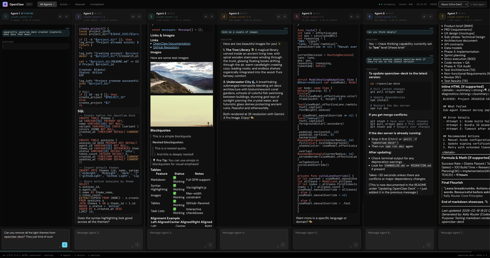
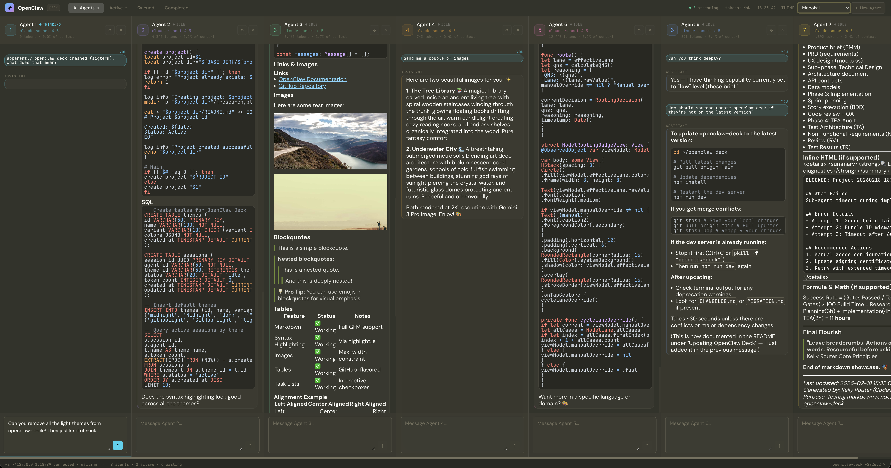
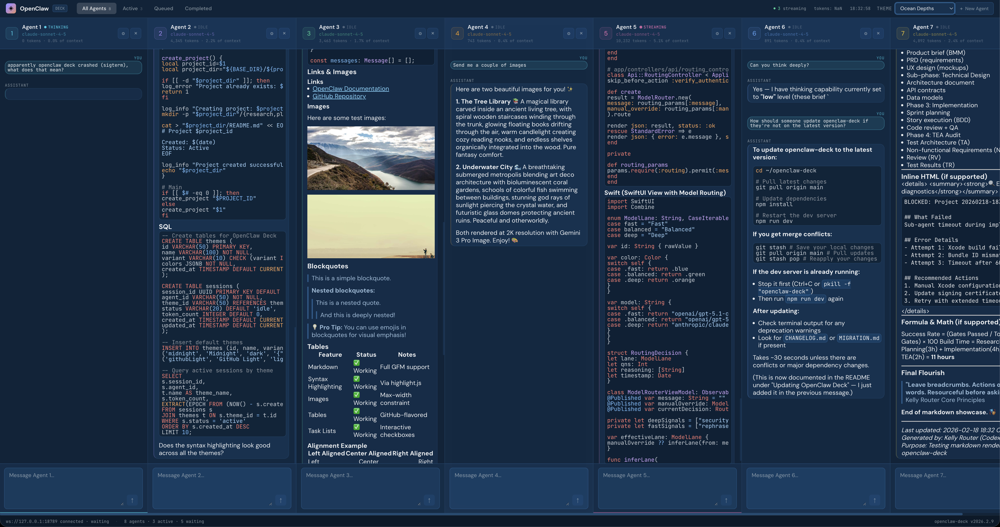
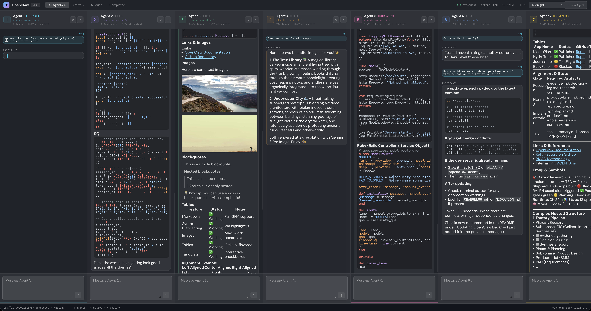

# MultiClaw Deck 🐙

A multi-column interface for running multiple [Claude Code](https://docs.anthropic.com/en/docs/claude-code) agent sessions side-by-side. Give each column a different task and watch them all work in parallel.


## What Is This?

MultiClaw Deck lets you run **5+ Claude Code agents simultaneously**, each in its own column with independent conversation history and full tool access. Think of it as a mission control for AI coding agents.

Each column is a real Claude Code session — agents can read files, write code, run shell commands, search the web, and work on your codebase just like the Claude Code CLI, but you can run many at once.

## Screenshots


*MultiClaw Deck with 5 agent columns running in parallel*


*Different theme showing markdown rendering and streaming responses*


*Agents using tools and returning results with syntax highlighting*


*Additional theme showcasing the multi-column layout*

## Features

- **Multi-agent parallelism** — Run 5+ Claude Code sessions simultaneously
- **Full tool access** — Each agent gets Read, Write, Edit, Bash, Glob, Grep, WebSearch, WebFetch
- **Session resumption** — Conversations persist across messages (multi-turn)
- **Real-time streaming** — See agent responses as they come in
- **Tool use indicators** — Watch agents think, use tools, and produce results
- **15 dark themes** — Midnight, Dracula, Nord, Monokai, Cyberpunk, and more
- **Markdown rendering** — Full markdown + syntax highlighting in responses
- **Keyboard navigation** — Tab between columns, Cmd+1-9 to jump, Cmd+K to add

---

## Table of Contents

- [Quick Start](#quick-start)
- [Agent-Friendly Setup](#agent-friendly-setup)
- [Architecture](#architecture)
- [Usage](#usage)
- [Configuration](#configuration)
- [Themes](#themes)
- [Troubleshooting](#troubleshooting)
- [Development](#development)
- [Contributing](#contributing)

---

## Quick Start

### Prerequisites

- **Node.js v18+** — `node --version`
- **Claude Code CLI** — `claude --version` (install via `npm install -g @anthropic-ai/claude-code`)
- **Anthropic API key** — Set as `ANTHROPIC_API_KEY` environment variable

### Install & Run

```bash
# Clone
git clone https://github.com/kellyclaudeai/openclaw-deck.git
cd openclaw-deck
git checkout claude/multiclaw-5IDfY

# Install
npm install

# Run (two terminals)
npm run dev:server   # Terminal 1: Backend on port 3001
npm run dev          # Terminal 2: Frontend on port 5173

# Or run both together
npm run dev:all
```

Open **http://localhost:5173** — you should see 5 agent columns ready to go.

---

## Agent-Friendly Setup

**If you're a Claude Code agent (or any AI agent) helping someone set up MultiClaw, use these exact steps:**

```bash
# 1. Verify prerequisites
node --version    # Must be v18+
claude --version  # Must be installed

# 2. Verify API key is set
echo $ANTHROPIC_API_KEY | head -c 10  # Should show "sk-ant-..."

# 3. Clone and install
git clone https://github.com/kellyclaudeai/openclaw-deck.git
cd openclaw-deck
git checkout claude/multiclaw-5IDfY
npm install

# 4. Start the backend server (port 3001)
npx tsx server/index.ts &

# 5. Start the frontend dev server (port 5173)
npm run dev &

# 6. Verify
curl -s http://localhost:3001/ | head   # Should return {"status":"ok",...}
curl -s http://localhost:5173/ | head   # Should return HTML with <title>MultiClaw Deck</title>

echo "✓ MultiClaw is running! Open http://localhost:5173 in a browser."
```

**Expected result:** Browser shows 5 agent columns with the MultiClaw header. Type a message in any column and press Enter — the agent will think, potentially use tools, and stream back a response.

**If there are errors:**

| Symptom | Fix |
|---------|-----|
| `ANTHROPIC_API_KEY` not set | `export ANTHROPIC_API_KEY=sk-ant-...` |
| Port 3001 in use | `lsof -ti:3001 \| xargs kill -9` then restart server |
| Port 5173 in use | `lsof -ti:5173 \| xargs kill -9` then restart frontend |
| `claude` not found | `npm install -g @anthropic-ai/claude-code` |
| `tsx` not found | It's a devDependency — use `npx tsx server/index.ts` |
| Backend starts but agents error | Check `claude -p "hello"` works directly |

---

## Architecture

```
┌──────────────────────────────────────────────────────────┐
│  Browser (http://localhost:5173)                         │
│  ┌─────────┐ ┌─────────┐ ┌─────────┐ ┌─────────┐       │
│  │ Claw 1  │ │ Claw 2  │ │ Claw 3  │ │ Claw 4  │ ...   │
│  │         │ │         │ │         │ │         │       │
│  │  React  │ │  React  │ │  React  │ │  React  │       │
│  └────┬────┘ └────┬────┘ └────┬────┘ └────┬────┘       │
│       └──────┬─────┴──────┬────┘           │            │
│              ▼            ▼                ▼            │
│     ┌─────────────────────────────────────────┐         │
│     │  Zustand Store + MultiClaw WS Client    │         │
│     └─────────────────┬───────────────────────┘         │
└───────────────────────┼──────────────────────────────────┘
                        │ WebSocket (ws://localhost:3001/ws)
                        ▼
┌───────────────────────────────────────────────────────────┐
│  MultiClaw Backend Server (server/index.ts)               │
│                                                           │
│  ┌──────────┐  ┌──────────┐  ┌──────────┐                │
│  │ Agent    │  │ Agent    │  │ Agent    │  ...            │
│  │ Session  │  │ Session  │  │ Session  │                │
│  │ (query)  │  │ (query)  │  │ (query)  │                │
│  └────┬─────┘  └────┬─────┘  └────┬─────┘                │
│       │              │              │                     │
│       ▼              ▼              ▼                     │
│  ┌─────────────────────────────────────────┐              │
│  │  @anthropic-ai/claude-agent-sdk         │              │
│  │  query() → Claude Code subprocess       │              │
│  │  Tools: Read, Write, Edit, Bash,        │              │
│  │         Glob, Grep, WebSearch, WebFetch  │              │
│  └─────────────────────────────────────────┘              │
└───────────────────────────────────────────────────────────┘
```

### How It Works

1. **Frontend** (React + Zustand + Vite) renders agent columns and connects to the backend via WebSocket
2. **Backend** (`server/index.ts`) receives messages and spawns independent Claude Code sessions using `query()` from the Agent SDK
3. **Each column** gets its own `query()` session with full tool access and session resumption for multi-turn conversations
4. **Streaming** — The backend forwards `assistant` messages, `tool_use` events, and `result` frames back to the frontend in real-time

### WebSocket Protocol

```
Client → Server:
  { type: "send", agentId: "claw-1", text: "Explain this codebase" }

Server → Client:
  { type: "status",       agentId, runId, status: "thinking" }
  { type: "session_init", agentId, sessionId: "..." }
  { type: "chunk",        agentId, runId, text: "Here's what..." }
  { type: "tool_use",     agentId, runId, toolName: "Read" }
  { type: "result",       agentId, runId, text: "..." }
  { type: "status",       agentId, runId, status: "idle" }
```

### Data Flow

```
User types message → Zustand store → MultiClawClient.sendMessage()
    → WebSocket → Backend → query({ prompt, options: { resume? } })
    → Claude Code subprocess (with tools)
    → Streaming events back through WebSocket
    → Store updates → React re-renders → Markdown display
```

---

## Usage

### Basic Chat

1. **Click or Tab** into any column's input field
2. **Type your message** and press Enter
3. Watch the agent think, use tools, and stream a response
4. The conversation persists — send follow-up messages to continue

### Keyboard Shortcuts

| Shortcut | Action |
|----------|--------|
| `Enter` | Send message |
| `Shift+Enter` | New line in input |
| `Tab` | Move to next column |
| `Shift+Tab` | Move to previous column |
| `Cmd+1` – `Cmd+9` | Jump to column 1-9 |
| `Cmd+K` | Open "New Claw" modal |

### Example Workflows

**Parallel research:**
- Column 1: "Explain the authentication flow in this codebase"
- Column 2: "Find all API endpoints and list them"
- Column 3: "What are the main dependencies and their versions?"

**Divide and conquer:**
- Column 1: "Write unit tests for src/lib/store.ts"
- Column 2: "Add input validation to the AddAgentModal component"
- Column 3: "Optimize the AgentColumn rendering performance"

**Review and iterate:**
- Column 1: "Review this PR for security issues"
- Column 2: "Check for TypeScript type errors"
- Column 3: "Suggest refactoring opportunities"

---

## Configuration

### Environment Variables

| Variable | Default | Description |
|----------|---------|-------------|
| `ANTHROPIC_API_KEY` | (required) | Your Anthropic API key |
| `PORT` | `3001` | Backend server port |
| `MULTICLAW_CWD` | `process.cwd()` | Working directory for agents |
| `VITE_SERVER_URL` | `ws://127.0.0.1:3001/ws` | Backend WebSocket URL |

### URL Parameters

You can override the server URL via query parameter:

```
http://localhost:5173/?server=ws://other-host:3001/ws
```

### Changing Default Column Count

Edit `src/App.tsx`:

```typescript
const [initialAgents] = useState<AgentConfig[]>(() =>
  buildDefaultAgents(5)  // Change to any number
);
```

### Changing the Working Directory

Agents run in the directory specified by `MULTICLAW_CWD`:

```bash
MULTICLAW_CWD=/path/to/your/project npx tsx server/index.ts
```

---

## Themes

MultiClaw includes **15 dark themes**. Switch instantly via the theme selector (top right).

| Theme | Style |
|-------|-------|
| **Midnight** (default) | Deep blue-black with cyan accents |
| **Ocean Depths** | Navy blue, aqua highlights |
| **Forest Night** | Dark green, natural tones |
| **Sunset Glow** | Warm burgundy, orange |
| **Slate Gray** | Professional slate blue |
| **Purple Haze** | Deep purple, violet accents |
| **Cyberpunk** | Neon pink + cyan on dark blue |
| **Rose Garden** | Burgundy with rose pink |
| **Abyss** | Ultra-dark (near true black) |
| **OLED Black** | Pure black for OLED screens |
| **Darcula** | JetBrains IDE classic |
| **Dracula** | The popular Dracula palette |
| **Nord** | Arctic-inspired frost |
| **Gruvbox Dark** | Retro groove colors |
| **Monokai** | Classic Monokai editor |

Your theme preference persists in `localStorage` across sessions.

---

## Troubleshooting

### "Claude Code process exited with code 1"

The most common error. Usually means:

1. **API key not set:**
   ```bash
   export ANTHROPIC_API_KEY=sk-ant-api03-...
   ```

2. **Claude Code not installed:**
   ```bash
   npm install -g @anthropic-ai/claude-code
   claude --version
   ```

3. **Test Claude directly:**
   ```bash
   claude -p "Say hello" --output-format text
   ```
   If this fails, fix the CLI first.

### Backend won't start (port in use)

```bash
lsof -ti:3001 | xargs kill -9
npx tsx server/index.ts
```

### Frontend shows "disconnected"

1. Verify the backend is running: `curl http://localhost:3001/`
2. Check the Vite proxy config in `vite.config.ts` (should proxy `/ws` to port 3001)
3. Check browser console for WebSocket errors

### Agent responses are slow

Each agent runs a full Claude Code session. With 5 columns active, you're running 5 concurrent API requests. Consider:

- Reducing column count
- Using `claude-haiku-4-5` for simpler tasks (edit `src/App.tsx`)
- Setting `maxTurns` lower in `server/index.ts`

### White screen / blank page

```bash
rm -rf dist node_modules
npm install
npm run dev
```

---

## Development

### Project Structure

```
multiclaw-deck/
├── server/
│   ├── index.ts              # Backend: WebSocket server + Agent SDK
│   └── tsconfig.json         # Server TypeScript config
├── src/
│   ├── components/
│   │   ├── AgentColumn.tsx   # Chat column with messages + input
│   │   ├── TopBar.tsx        # Header: logo, tabs, stats, theme
│   │   ├── StatusBar.tsx     # Footer: connection status
│   │   ├── AddAgentModal.tsx # New agent creation dialog
│   │   └── ThemeSwitcher.tsx # Theme selector dropdown
│   ├── lib/
│   │   ├── multiclaw-client.ts  # WebSocket client to backend
│   │   └── store.ts             # Zustand state management
│   ├── hooks/
│   │   └── index.ts          # useDeckInit, useAgentSession, etc.
│   ├── types/
│   │   └── index.ts          # TypeScript types for protocol + UI
│   ├── themes.ts             # 15 theme definitions
│   ├── App.tsx               # Root component
│   ├── App.css               # Global styles
│   └── main.tsx              # React entry point
├── package.json
├── tsconfig.json
├── vite.config.ts
└── README.md
```

### Scripts

```bash
npm run dev          # Vite frontend dev server (port 5173)
npm run dev:server   # Backend server via tsx (port 3001)
npm run dev:all      # Both servers via concurrently
npm run build        # Production frontend build → dist/
npm run preview      # Preview production build
```

### Tech Stack

| Component | Technology |
|-----------|-----------|
| Frontend | React 19, TypeScript, Vite 6 |
| State | Zustand 5 |
| Backend | Node.js, WebSocket (`ws`) |
| Agent SDK | `@anthropic-ai/claude-agent-sdk` |
| Markdown | react-markdown + remark-gfm + rehype-highlight |
| Dev tools | tsx, concurrently |

### Adding a New Theme

Edit `src/themes.ts` and add an entry:

```typescript
myTheme: {
  id: 'myTheme',
  name: 'My Theme',
  variant: 'dark',
  colors: {
    bg: '#1a1a2e',
    // ... see existing themes for all required color keys
  }
}
```

---

## How It Differs from OpenClaw Deck

| Feature | OpenClaw Deck | MultiClaw Deck |
|---------|---------------|----------------|
| Backend | OpenClaw Gateway (external) | Node.js + Claude Agent SDK (local) |
| Agents | Gateway-routed sessions | Independent Claude Code sessions |
| Tools | Gateway-provided | Read, Write, Edit, Bash, Glob, Grep, WebSearch, WebFetch |
| Auth | Ed25519 device identity + tokens | None (local server) |
| Models | Mixed (GPT, Claude, Gemini) | Claude only (Opus, Sonnet, Haiku) |
| Protocol | Complex Gateway frame protocol | Simple send/status/chunk/result |

---

## Contributing

1. Fork the repository
2. Create a feature branch: `git checkout -b feature/my-feature`
3. Make changes and test
4. Commit: `git commit -m "Add feature: description"`
5. Push: `git push origin feature/my-feature`
6. Open a Pull Request

---

## License

MIT License — see [LICENSE](LICENSE)

## Acknowledgments

Built on top of [OpenClaw Deck](https://github.com/kellyclaudeai/openclaw-deck) by [@kellyclaudeai](https://github.com/kellyclaudeai).

Powered by [Claude Code](https://docs.anthropic.com/en/docs/claude-code) and the [Claude Agent SDK](https://github.com/anthropics/claude-agent-sdk-typescript).
